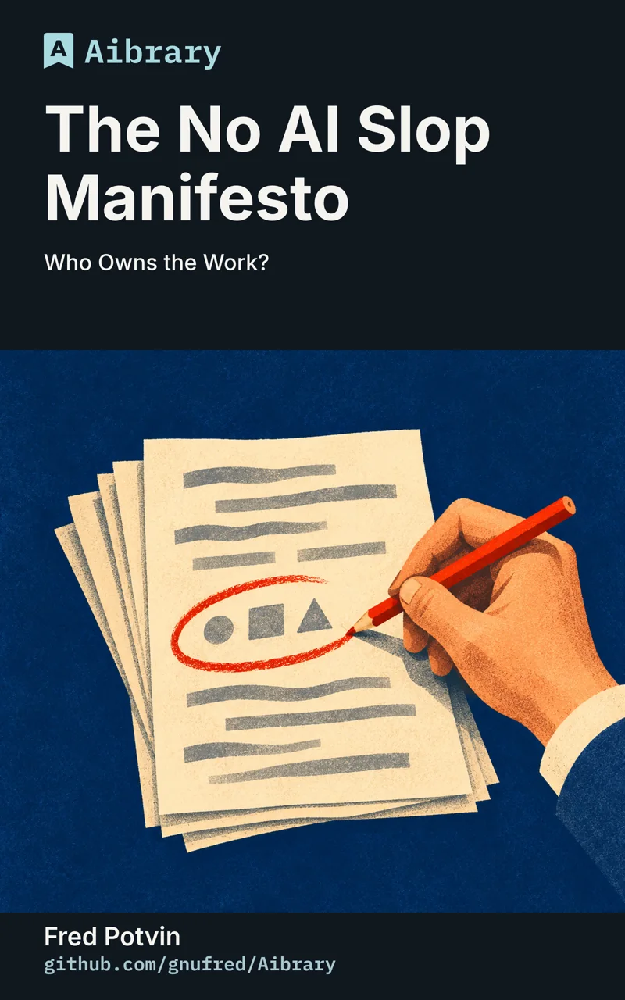

# The No AI Slop Manifesto

*Who Owns the Work?*

[Cover files and rendering instructions](cover/README.md)

Continue editing the [reviewed manuscript](04-review-book/the-no-ai-slop-manifesto.md). The draft preserves the complete manuscript before editorial review.

| Skill stage | Material | Git milestones |
| --- | --- | --- |
| `aibrary-01-plan-book` | [Book plan](01-plan-book/plan.md) | Initial plan `33206c1`, subtitle revision `211d123` |
| `aibrary-02-research-sources` | [Source and permissions index](02-research-sources/index.md), [licensed excerpt](02-research-sources/sources/mockus-et-al-2026-review-time-excerpt.md) | Source research `619bdc0`, additional source checks `1900859` and `b8b0832` |
| `aibrary-03-draft-book` | [Complete pre-review draft](03-draft-book/the-no-ai-slop-manifesto.md) | Opening chapters `1900859`, middle chapters `327e93c`, complete draft `b8b0832` |
| `aibrary-04-review-book` | [Reviewed manuscript](04-review-book/the-no-ai-slop-manifesto.md), [editorial review and diff](04-review-book/review-diff.md) | Accepted editorial changes `82d37fc` |

The draft EPUB was removed in `b263037` to make room for editorial review. The reviewed Markdown is the source for the next export.
