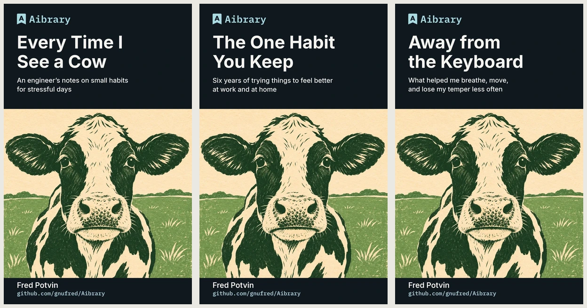

# The habits I kept

*Applying my hacking mindset to heal myself*
Fred Potvin

[EPUB cover (JPEG)](cover.jpg) · [Web cover (WebP)](cover.webp)

Fred chose the green cow portrait from the [original cover prototypes](prototypes/README.md). The cow is a reminder he sees in the countryside where he lives. It helps him remember to stay calm, especially when he feels like shouting at his kids. [Selected source artwork](prototypes/the-cow/artwork.png)

## Earlier title studies

| Title | Subtitle | Full-size cover |
| --- | --- | --- |
| Every Time I See a Cow | An engineer’s notes on small habits for stressful days | [JPEG](title-studies/every-time/cover.jpg) · [WebP](title-studies/every-time/cover.webp) |
| The One Habit You Keep | Six years of trying things to feel better at work and at home | [JPEG](title-studies/one-habit/cover.jpg) · [WebP](title-studies/one-habit/cover.webp) |
| Away from the Keyboard | What helped me breathe, move, and lose my temper less often | [JPEG](title-studies/keyboard/cover.jpg) · [WebP](title-studies/keyboard/cover.webp) |
