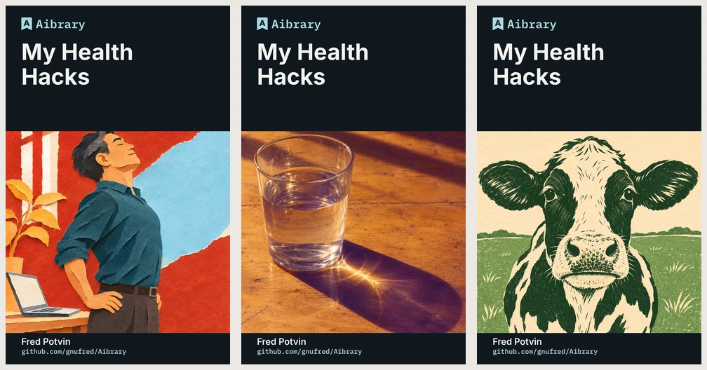

# Three covers for *My Health Hacks*

| Concept | Connection to the book | Files |
| --- | --- | --- |
| The hourly break | The cut-paper figure steps back from the laptop and takes the slow breath Fred describes on the first page. | [JPEG](hourly-break/cover.jpg) · [WebP](hourly-break/cover.webp) · [Source art](hourly-break/artwork.png) |
| The first glass | Morning light through an ordinary glass of water puts the emphasis on how small a first habit can be. | [JPEG](first-glass/cover.jpg) · [WebP](first-glass/cover.webp) · [Source art](first-glass/artwork.png) |
| The cow | A green woodcut-style portrait takes its subject from the cows near Fred’s home that remind him to stay calm. | [JPEG](the-cow/cover.jpg) · [WebP](the-cow/cover.webp) · [Source art](the-cow/artwork.png) |

These are exploratory covers. The three source illustrations were generated with ImageGen for this book. Each uses the [Aibrary cover creator](../../../../tools/cover-creator/README.md) with the title broken after “Health,” the default title size, and the author credit “Fred Potvin.”
