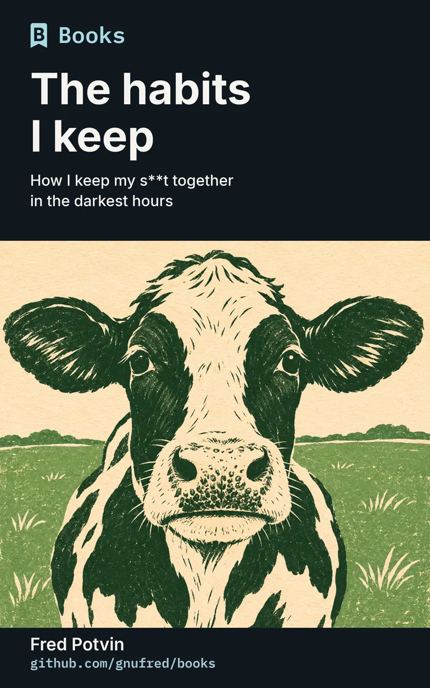

# The habits I keep

*How I keep my s\*\*t together in the darkest hours*

> Hearing that AI could take over governments and seeing my fellow IT engineers lose their jobs really freaked me out. Breathing and moving helped me get myself together. Now I want to help you too.

Read the [EPUB](the-habits-i-keep.epub) or [Fred’s rewritten manuscript](05-human-edit/manuscript.md).

[Cover files and artwork](cover/README.md)

| Stage | Material | Milestone |
| --- | --- | --- |
| `books-01-plan-book` | [Book plan and chapter outline](01-plan-book/plan.md) | First plan `11d6603`, accepted outline `723391c` |
| `books-02-research-sources` | [Source and permissions index](02-research-sources/index.md), [cleared trial excerpt](02-research-sources/sources/buijze-2016-illness-days.md), [author’s notes](02-research-sources/leads.md) | Chapter research and reuse decisions `b43b0ce` |
| `books-03-draft-book` | [Complete pre-review manuscript](03-draft-book/the-habits-i-keep.md) | Opening chapters `38c1bf8`, middle chapters and Fred’s new firsthand details `58d2c0a`, complete draft `c0e97a3` |
| `books-04-review-book` | [First read](04-review-book/first-read.md), [reviewed manuscript](04-review-book/the-habits-i-keep.md), [editorial changes and checks](04-review-book/review-diff.md) | Review start `84f5394`, manuscript-only first read `919547b`, edited manuscript `53b4306` |

Fred completed his human rewrite at `02bd78c`.

The `codex/book-health-hacks` worktree started at Books revision `935c059`.

The book reserves rights in Fred’s original text. The earlier edition credits its CC BY 4.0 cold-shower excerpt in chapter 4. The rewrite cites the study in “Cold showers.”
